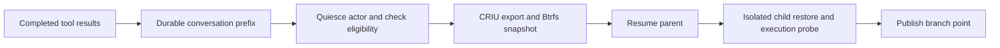

# AgentFork

AgentFork saves an agent's environment and conversation at completed tool boundaries, checks that the environment actually restores, and forks independent continuations from those checkpoints.

It combines Btrfs copy-on-write filesystem snapshots, CRIU process checkpoints, a Claude Code harness, a branch-search controller, and a local trajectory viewer. The current backend runs on a Linux CPU host without KVM.

[中文说明](README.zh-CN.md) · [How checkpointing works](docs/checkpoints.md) · [Validation and limitations](docs/quality.md)

## What qualifies as a checkpoint?

A completed tool call is a **candidate**, not a promise of recoverability. AgentFork waits for the matching native transcript to be durable, stops the actor at the gateway before the next model request, checks the process tree and sockets, exports process memory, and snapshots the filesystem while the source is stopped. It then resumes the parent and restores a disposable, network-isolated child. The child must expose tools and successfully execute a shell tool before the checkpoint is published. Applications can add their own restore probe.



Saved state includes process memory, registers, supported kernel resources, the container root filesystem, and the exact model conversation prefix. Remote services and host-external state are outside the checkpoint.

## Install

Use Python 3.12+, a Linux host with rootful Podman, runc, CRIU, Btrfs, catatonit, iproute2, iptables/ip6tables, and Zstandard. A working CRIU kernel configuration and a mounted Btrfs store are required. AgentFork does not format disks, enable KVM, or change host mounts for you.

```bash
git clone https://github.com/albert-y1n/AgentFork.git
cd AgentFork
python3 -m venv .venv
.venv/bin/pip install -e '.[dev]'
export AGENTFORK_HOME="$PWD"

# Build the static runtime with Go 1.25+.
cd runtime
go generate ./tools
CGO_ENABLED=0 go build -o agentfork-runtime .
cd ..

# Configure a separate Podman database for this workspace.
.venv/bin/python scripts/configure_podman.py
.venv/bin/agentfork doctor --store /your/mounted/btrfs/store
```

The runtime build embeds a checksum-pinned ripgrep release; `go generate` downloads it. No Claude Code binary, container image, dataset, API key, or experimental trajectory is distributed here.

## Fork an environment

```bash
.venv/bin/python examples/fork.py \
  --store /your/mounted/btrfs/store \
  --runtime "$PWD/runtime/agentfork-runtime"
```

The example restores a child from an earlier file state, changes the child, and checks that the parent and child are independent. `CriuBtrfs` also accepts an asynchronous `validation_probe(child)` for application-specific checks. See [checkpoint semantics](docs/checkpoints.md).

## Run branch search on Terminal Bench

Install the optional benchmark dependency into the interpreter that will run the verifier, and provide a working Docker daemon for Harbor's separate verifier containers. Place an independently obtained Harbor-format dataset under `datasets/terminal-bench`, or set `AGENTFORK_TASKS`. Install Claude Code separately and point to its **native Linux executable**; the tested adapter does not copy an npm JavaScript launcher and Node installation into the task image.

```bash
.venv/bin/pip install -e '.[benchmark]'
export AGENTFORK_CLAUDE_BINARY=/absolute/path/to/native/claude
export AGENTFORK_MODEL=your-model
export AGENTFORK_BASE_URL=https://your-provider.example
read -rs AGENTFORK_API_KEY
export AGENTFORK_API_KEY

.venv/bin/agentfork inventory
.venv/bin/agentfork run --output runs/example \
  --btrfs-store /your/mounted/btrfs/store \
  --mode agentfork-only --checkpoint-backend criu \
  --task-workers 1 --concurrency 2 --tasks your-task
.venv/bin/agentfork view --campaign runs/example
```

The actor endpoint must implement Anthropic-compatible `/v1/messages`; the analyst/reviewer uses OpenAI-compatible `/v1/chat/completions` at the same base URL. A chat-only API is insufficient for this adapter. Generation limits and context assumptions are configurable through the `AGENTFORK_*` variables described in [configuration](docs/configuration.md).

GPU and multi-container benchmark tasks are excluded. Original task definitions and verifiers remain external. Completed task checkpoints are retained by default; `--discard-completed-checkpoints` explicitly releases their filesystem snapshots while keeping transcripts and results. Retained snapshots and checkpoint archives can occupy substantial disk space.

## Inspect and test

```bash
.venv/bin/agentfork audit runs/example/task/attempts/root-0/checkpoints.json \
  --store /your/mounted/btrfs/store
.venv/bin/pytest -q
cd runtime && go test ./...
```

`audit` distinguishes historical validation from material availability now. It verifies hashes by default, but does not claim a new live restore. Integration tests require explicit host configuration; unit tests do not make model API calls.

## Scope

This is research infrastructure with conservative admission and restore validation. It supports substantially more state than filesystem-only snapshots, including tested local service connections, CPU training state and userspace emulation. It does not provide universal process migration, cross-host portability, transactional rollback of external services, or a security boundary for untrusted workloads. See the [support matrix and evidence](docs/quality.md).

Source is licensed under Apache-2.0. Third-party copyright and origin information is retained in [NOTICE](NOTICE) and [THIRD_PARTY.md](THIRD_PARTY.md).
